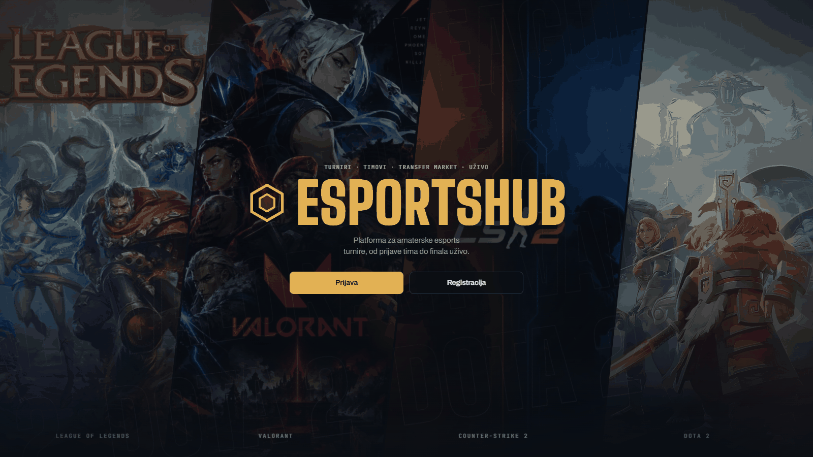
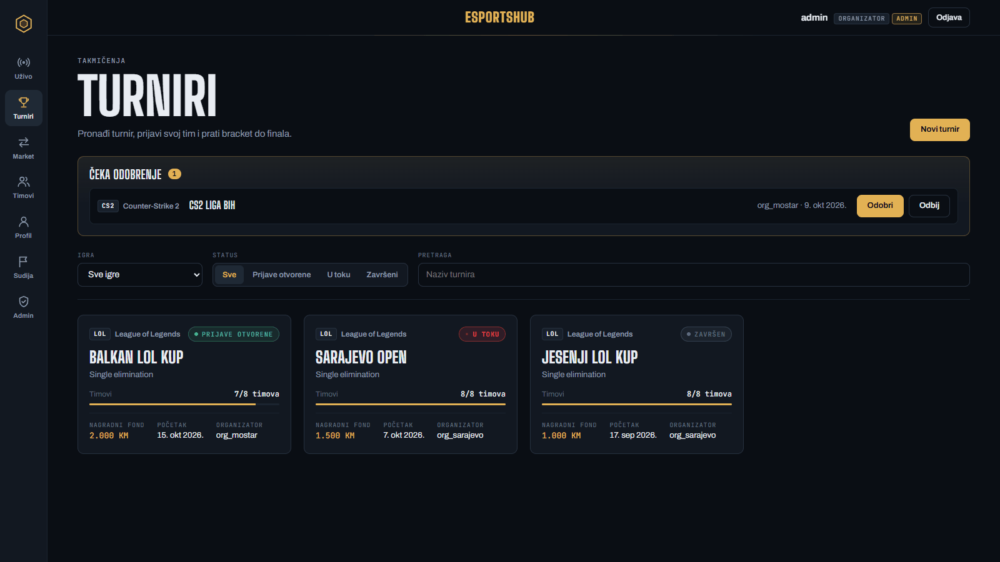
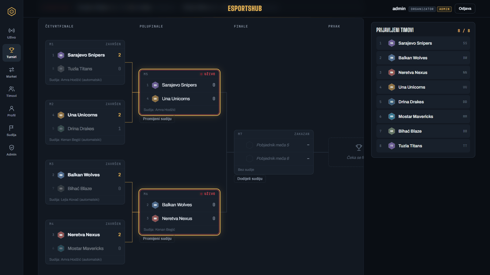
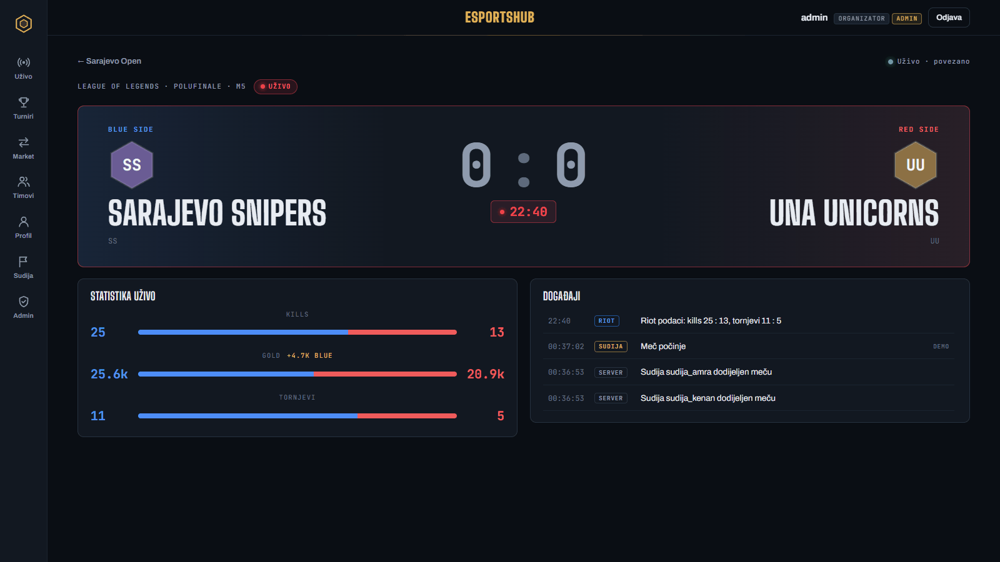
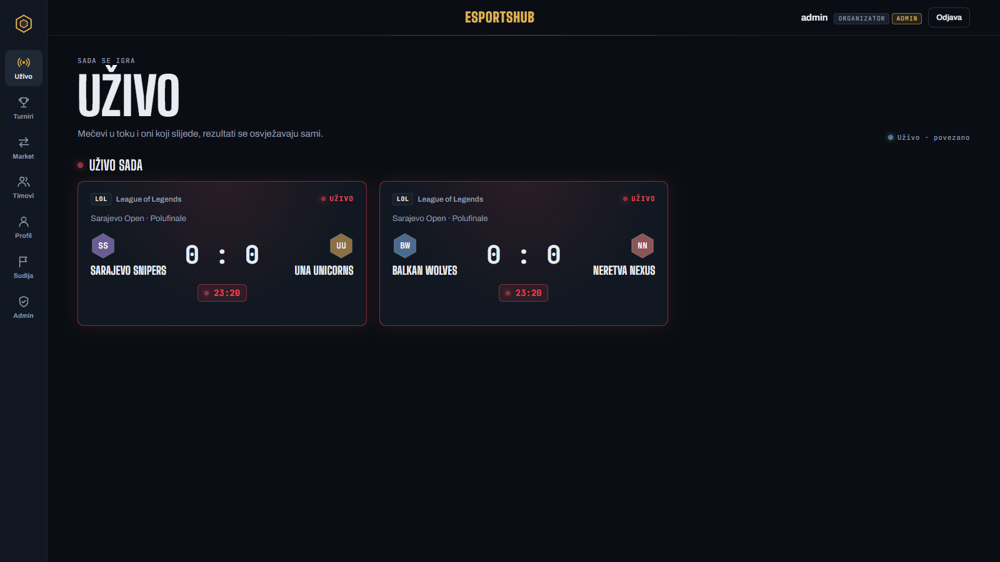
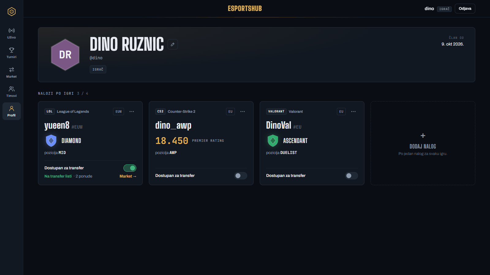
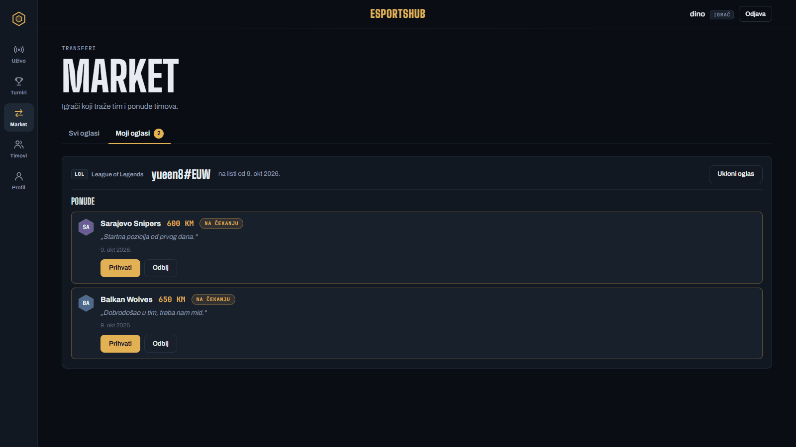
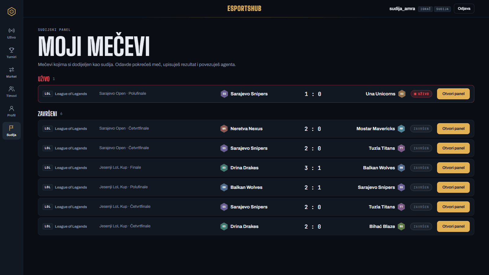
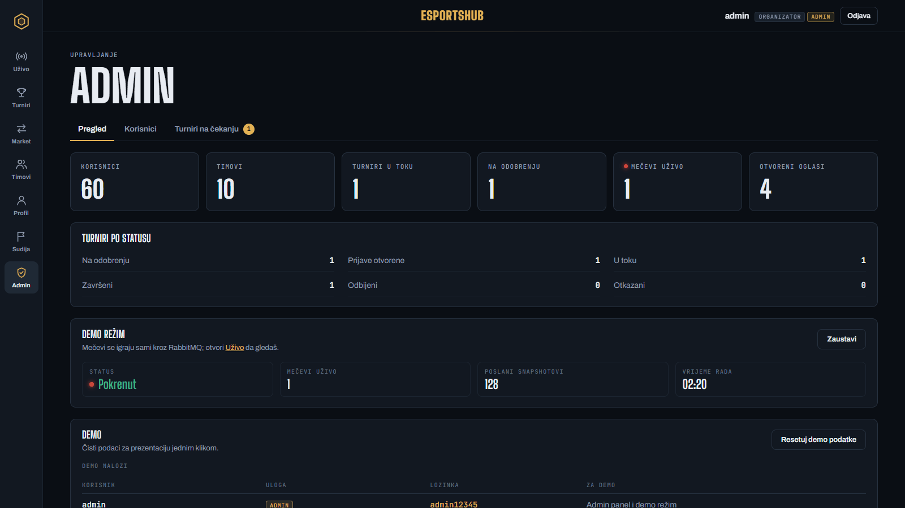
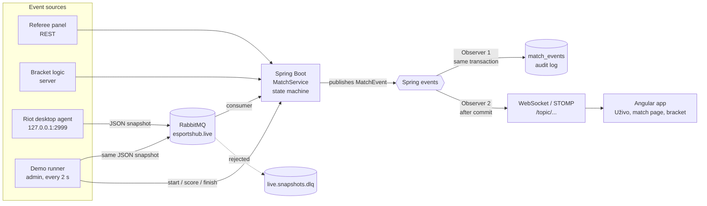

# EsportsHub

> eSports tournament platform for **League of Legends** (multi-game ready) — a player transfer market, tournaments with auto-generated brackets, and real-time match tracking fed by referees and live in-game data. Built with **Spring Boot** and **Angular**.

[](https://github.com/dinoruznic/EsportsHub/actions/workflows/ci.yml)


[Overview](#overview) · [Demo](#demo-za-prezentaciju) · [Architecture](#architecture) · [Design Patterns](#design-patterns) · [Database](#database) · [Testing](#testing) · [Getting Started](#getting-started) · [API](#api-overview) · [Project Structure](#project-structure) · [Roadmap](#roadmap)

## Overview

> 📄 **O projektu (na bosanskom):** šta je EsportsHub, koji problem rješava, uloge, tokovi i rječnik pojmova za čitaoce koji ne igraju igre: [docs/O-PROJEKTU.md](docs/O-PROJEKTU.md)

EsportsHub is a platform for amateur esports competition. Players build per-game profiles and get signed through a **transfer market**, organizers run **tournaments** with automatically generated brackets, and every match is **streamed live** to spectators.

The system is an **event + broadcast layer**, not a game controller: server bracket logic, referee input and live in-game data all become the same kind of domain event, which is logged for integrity and pushed to everyone watching.

| | Feature |
|---|---|
| 🚪 | **Landing & auth** — full-screen landing page with login and registration on the same page, JWT sessions, everything else behind login |
| 🔐 | **Roles** — PLAYER, ORGANIZER, REFEREE and ADMIN, several roles per user, role-aware navigation and route guards |
| 🏆 | **Tournaments** — organizer-created, admin-approved, team registration with capacity limits, filters by status and game |
| 🧩 | **Live bracket** — single elimination with standard seeding; the bracket view updates over WebSocket while matches are played and crowns the champion |
| 📡 | **Live match page** — scoreboard, game clock, kills, gold lead and towers from live snapshots, plus an event feed (referee, Riot data, server, demo) pushed over STOMP |
| 🔴 | **Uživo** — every live match and the next scheduled ones on one page, refreshed in real time |
| 👤 | **Profiles & game accounts** — one account per game with region, position and rank; tier ranks (LoL, Valorant) or numeric rating (CS2, Dota 2) |
| 👥 | **Teams** — captain-owned rosters; a member's game must match the team's game |
| 💱 | **Transfer market** — players list themselves, captains make offers, accepting an offer signs a contract and moves the player into the team (Facade) |
| ⚖️ | **Referee panel** — assigned matches, start / score / finish controls, automatic referee assignment with conflict-of-interest rules, and the ready-to-copy agent command |
| 🛠️ | **Admin panel** — overview tiles, user search with role management, pending tournament approval, one-click demo data and an automatic demo mode |
| 🎮 | **Riot live data** — a command-line agent on the referee's PC reads the League client's local API and streams game state through RabbitMQ |

**Multi-game by design.** Games are data, not code: a new game is a row in `games` plus its ranks, positions and regions. Teams, tournaments, brackets and the market work for any game without a code change, and the profile form adapts to the game (`TIER` → rank dropdown, `NUMERIC` → rating field).

## Demo za prezentaciju

Everything needed for a live presentation is built into the admin panel. Run the three commands below in three separate terminals from the repository root. The demo endpoints exist only while `esportshub.demo.enabled` is `true` (the default in `application.yaml`; the integration test profile turns it off).

```bash
docker compose up -d                  # terminal 1
cd backend && ./mvnw spring-boot:run  # terminal 2
cd frontend && npm start              # terminal 3
```

1. Open http://localhost:4200 and log in as `admin` / `admin12345`.
2. **Admin → Pregled → "Resetuj demo podatke"** and confirm. All data except the admin account is deleted and the database is filled with demo data through the normal services, so every business rule holds.
3. **"Pokreni demo mečeve"** — the server keeps up to two matches of the ongoing demo tournament live, sends a snapshot every 2 s through RabbitMQ (game clock from 14:00, kills, gold lead, towers), ends a map about every minute and finishes the series (BO3, final BO5). The winner advances and the next match gets a referee automatically. The demo stops by itself when the tournament is over.
4. Open **Uživo** or the tournament bracket and watch it update without refreshing. Events played by the demo carry a `DEMO` tag in the match feed.

What the reset creates (all names are fictional demo data):

| | |
|---|---|
| Tournaments | one completed tournament with a champion and full match history · one ongoing tournament with scheduled matches and assigned referees, played by the demo mode · one open for registration with a free slot, so a team can register live · one waiting for admin approval |
| Teams | eight LoL teams and two CS2 teams with full rosters |
| Market | players on the transfer list with pending offers from teams |
| Accounts | organizers, referees, captains and players for every role; the admin panel lists them with their passwords after the reset |

To show the real agent instead, log in as the match referee, copy the agent command from the referee panel and run it:

```bash
java -jar agent/target/esportshub-agent.jar --mock --start=14:00 --interval=2 --match-key=<key>
```

The same flow is scripted for the IntelliJ HTTP client in `backend/http/demo-reset.http` and `backend/http/demo-mode.http`.

### Screenshots

Taken at 1600×900 right after "Resetuj demo podatke" with the demo mode running.

| | |
|---|---|
|  Landing with login and registration |  Tournaments |
|  Live bracket |  Live match page with snapshots and the DEMO tag |
|  Uživo |  Player profile with three game accounts |
|  Market — offers on a player's listing |  Referee panel |
|  Admin panel — overview, demo mode and demo accounts | |

## Architecture



- **One event pipeline.** `MatchService` only publishes `MatchEvent`s and does not know who listens. The event logger writes them to `match_events` inside the same transaction; the broadcaster pushes them to spectators **after commit**, so nobody ever sees a result that is later rolled back.
- **Live data is decoupled.** The Riot agent never talks to the backend directly — it publishes to RabbitMQ with a least-privilege broker user (write-only to one exchange). Invalid snapshots (unknown match key, match not live, malformed JSON) are dead-lettered instead of retried forever.
- **The demo uses the real path.** The demo runner starts matches through `MatchService` and publishes snapshots to the same exchange with the same routing key and message format as the agent, so the RabbitMQ consumer, the event log and WebSocket broadcasting all run exactly as in a real game.
- **Match keys are secrets.** A match's agent key is only visible to its referee, the organizer and admins; public views never expose it.

## Design Patterns

| Pattern | Where | Why |
|---|---|---|
| **Strategy** | `BracketStrategy`, `SingleEliminationStrategy`, `BracketStrategyResolver` | Bracket format is chosen by `tournament.format`; a new format is a new class, the service is unchanged |
| **Builder** | `BracketBuilder` | Strategies describe rounds, matches and advancement links step by step; the service persists the finished plan in two passes |
| **Facade** | `MarketService.acceptOffer` | One call signs a contract, adds the team membership, closes the listing, resets market status and rejects all competing offers |
| **Observer** | `MatchEvent` → `MatchEventLogger`, `MatchBroadcaster` | Logging and live broadcasting are independent listeners; adding WebSocket and Riot data required no change to match logic |
| **State machine** | `MatchStatus.canTransitionTo`, `TournamentStatus` | Only legal transitions are allowed (e.g. `SCHEDULED → LIVE → FINISHED`); anything else is rejected with `409` |

**Tournament lifecycle:** `PENDING → REGISTRATION → ONGOING → COMPLETED` (or `REJECTED` / `CANCELLED`).
**Match lifecycle:** `SCHEDULED → LIVE → FINISHED` (or `CANCELLED`). Finishing a match moves the winner into its slot of the next match; finishing the final completes the tournament.

## Tech Stack

| Layer | Technology |
|---|---|
| Backend | Spring Boot 4.1 (Java 21, Maven) — Web MVC, Data JPA, Security, Validation |
| Database | PostgreSQL 16, schema managed by **Liquibase** (`ddl-auto: none`) |
| Security | Spring Security, stateless JWT (jjwt), method-level RBAC (`@PreAuthorize`) |
| Real-time | WebSocket + STOMP (`/ws`, topics under `/topic`) |
| Messaging | RabbitMQ (topic exchange, durable queue, dead-letter queue) |
| Live data agent | Plain Java 21 app reading the Riot Live Client Data API |
| API docs | springdoc-openapi (Swagger UI) |
| Testing | JUnit 5, Mockito, AssertJ, Testcontainers (PostgreSQL + RabbitMQ), Awaitility, JaCoCo |
| CI | GitHub Actions |
| Frontend | Angular 22 — standalone components, signals, reactive forms, STOMP.js over WebSocket, Vitest |

## Database

The schema lives in versioned **Liquibase** migrations (`backend/src/main/resources/db/changelog/`) and is rebuilt identically on any machine — the test suite does exactly that on an empty database on every run.

Key ideas:
- A person (`users`) is separated from their per-game identity (`game_accounts`, one per game).
- Per-game reference tables (`game_ranks`, `game_positions`, `game_regions`) and `games.rank_type` drive validation and the profile form.
- Competition: `tournaments` → `tournament_registrations` → `rounds` → `matches` (self-reference `next_match_id` forms the bracket tree).
- Live & integrity: `match_events` (JSON payload, actor, source: `REFEREE` / `ORGANIZER` / `ADMIN` / `RIOT` / `SISTEM` / `DEMO`), `live_game_snapshots`.
- Market: `transfer_listings` → `transfer_offers` → `contracts`.

## Testing

```bash
cd backend
./mvnw verify        # requires Docker (Testcontainers)

cd frontend
npm run test:ci      # Vitest
npm run build
```

- **226 backend tests**, all passing — unit tests (pure JUnit + Mockito, no Spring context) for the core logic and end-to-end integration tests through real HTTP, PostgreSQL and RabbitMQ in containers.
- Integration tests run in the `test` profile with the demo disabled and share one Spring context; the demo tests enable it in a second context. The full suite runs in about two minutes.
- **97 % line coverage** (JaCoCo). The build fails below 90 %. Report: `backend/target/site/jacoco/index.html`.
- Highlights: bracket seeding for 2–16 teams, the full match state-machine matrix, the market facade, a whole tournament from creation to champion over HTTP, WebSocket message order with a real STOMP client, RabbitMQ ingestion including dead-lettering, an idempotent demo reset, and the demo runner playing a whole tournament to the end through RabbitMQ.
- **206 frontend tests** (Vitest) for pages, API error mapping, live stores and the admin demo controls.
- The agent has its own unit tests (Riot JSON mapping, side swap, turret attribution, mock generator).
- **CI:** every push to `main` runs the backend, agent and frontend builds on GitHub Actions.

Manual API scenarios for the IntelliJ HTTP client live in `backend/http/` (one file per feature).

## Getting Started

**Prerequisites:** JDK 21, Docker Desktop.

```bash
# 1. PostgreSQL + RabbitMQ
docker compose up -d

# 2. Backend
cd backend
./mvnw spring-boot:run
```

On startup Liquibase builds the schema and a default **admin** account is created (`admin` / `admin12345`, override with `ADMIN_PASSWORD`).

| What | URL |
|---|---|
| Swagger UI | http://localhost:8080/swagger-ui.html |
| Live spectator page | http://localhost:8080/spectator.html?t=&lt;tournamentId&gt; |
| RabbitMQ management | http://localhost:15672 (`esportshub` / `esportshub`) |

**Frontend** (Angular, requires Node 24.15+; version in `frontend/.nvmrc`):

```bash
cd frontend
npm install
npm start
```

Open http://localhost:4200. The backend must be running on `:8080`, because the dev server proxies `/api` and `/ws` to it (`frontend/proxy.conf.json`).

The start page is a full-screen landing with login and registration on the same page; the rest of the app is only reachable after logging in. Demo admin: `admin` / `admin12345`.

For a presentation, follow [Demo za prezentaciju](#demo-za-prezentaciju). The older step-by-step API demo still works: run `backend/http/demo-setup.http`, open the spectator link it prints, then step through `backend/http/demo-play.http`.

**Riot agent** (see [`agent/README.md`](agent/README.md)):

```bash
cd agent
./mvnw package
java -jar target/esportshub-agent.jar --mock --match-key=<key>   # plausible fake data
java -jar target/esportshub-agent.jar --match-key=<key>          # real League game on this PC
```

For a demo that looks like a game already in progress, `--start=MM:SS` (env `AGENT_START`, only together with `--mock`) starts the mock at that game time with plausible kills, gold and towers. The referee panel offers this command ready to copy:

```bash
java -jar agent/target/esportshub-agent.jar --mock --start=14:00 --interval=2 --match-key=<key>
```

## API Overview

Authentication is stateless: log in, then send `Authorization: Bearer <token>`. Full reference in Swagger UI.

| Area | Endpoints |
|---|---|
| Auth | `POST /api/auth/register`, `POST /api/auth/login` |
| Games | `GET /api/games`, `GET /api/games/{id}/ranks \| positions \| regions` |
| Profiles | `/api/me/game-accounts` (CRUD), `GET /api/players/{username}/game-accounts` |
| Teams | `/api/teams`, `/api/teams/{id}`, `/api/teams/{id}/members` |
| Market | `/api/market/listings`, `/listings/{id}/offers`, `/offers/{id}/accept \| reject \| withdraw`, `/teams/{id}/contracts` |
| Tournaments | `/api/tournaments`, `/pending`, `/{id}/approve \| reject`, `/{id}/registrations`, `/{id}/bracket` |
| Matches | `/api/matches/{id}`, `/referee`, `/start`, `/score`, `/finish`, `/events`, `/live`, `/agent-key` |
| Admin | `GET /api/admin/users`, `GET /api/admin/stats`, `POST /api/admin/users/{username}/roles`, `DELETE /api/admin/users/{username}/roles/{role}` |
| Demo (admin) | `POST /api/admin/demo/reset`, `POST /api/admin/demo/start`, `POST /api/admin/demo/stop`, `GET /api/admin/demo/status` |
| WebSocket | `/ws` → subscribe `/topic/tournaments/{id}` or `/topic/matches/{id}` |

## Project Structure

```
EsportsHub/
├── backend/
│   ├── src/main/java/com/esportshub/backend/
│   │   ├── auth/          # JWT login/register, filter
│   │   ├── user/ admin/   # users, roles, role management
│   │   ├── game/          # game catalog + per-game ranks/positions/regions
│   │   ├── gameaccount/   # per-game player profiles
│   │   ├── team/          # teams and rosters
│   │   ├── market/        # listings, offers, contracts (Facade)
│   │   ├── tournament/    # tournaments, approval, registrations
│   │   ├── bracket/       # Strategy + Builder bracket generation
│   │   ├── match/         # match state machine, events, WebSocket broadcast (Observer)
│   │   ├── live/          # RabbitMQ ingestion of live game snapshots
│   │   ├── demo/          # demo data reset + seed, automatic demo matches
│   │   └── config/        # security, OpenAPI, WebSocket, bootstrap
│   ├── src/main/resources/
│   │   ├── db/changelog/  # Liquibase migrations
│   │   └── static/        # spectator demo page
│   ├── src/test/          # unit + integration tests (Testcontainers)
│   └── http/              # IntelliJ HTTP client scenarios and live demo
├── agent/                 # Riot Live Client Data desktop agent
├── infra/rabbitmq/        # broker definitions (least-privilege agent user)
├── .github/workflows/     # CI
├── frontend/              # Angular app
│   └── src/app/
│       ├── core/          # API clients, auth, STOMP realtime service
│       ├── layout/        # app shell and navigation
│       ├── pages/         # landing, turniri, mecevi, uzivo, profil, igraci, timovi, market, sudija, admin
│       └── shared/        # reusable UI pieces
└── docker-compose.yml     # PostgreSQL + RabbitMQ
```

## Roadmap

- [x] Generic multi-game schema with Liquibase
- [x] JWT authentication and role-based authorization
- [x] Per-game player profiles (tier or numeric ranks)
- [x] Teams and rosters
- [x] Transfer market (Facade)
- [x] Tournaments with admin approval and registrations
- [x] Bracket generation (Strategy + Builder)
- [x] Live match control (state machine, referee, winner advancement)
- [x] Event log + WebSocket broadcasting (Observer)
- [x] RabbitMQ ingestion + Riot desktop agent
- [x] Unit + integration tests, coverage gate, CI
- [x] Angular frontend (landing, tournaments, live bracket, live match page, Uživo, profiles, teams, market)
- [x] Referee panel with automatic referee assignment and conflict-of-interest rules
- [x] Admin panel with roles, statistics and tournament approval
- [x] One-click demo data and automatic demo mode through RabbitMQ
- [ ] Desktop GUI for the agent (download for referees)
- [ ] Dual result confirmation when no referee is assigned
- [ ] Double elimination format

---

*Academic project — Spring & Angular academy.*
